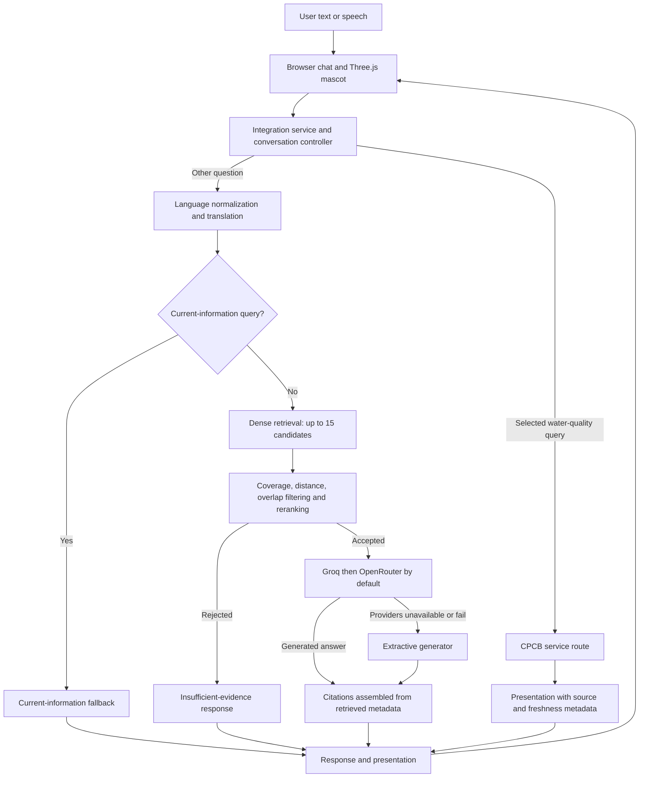

# Evidence-Gated Environmental RAG with Query-Conditioned Hybrid Retrieval and Traceable Citations for Ganga Conservation Awareness

## Abstract

This paper describes Ganga AI Mascot (PRJ_316), a research prototype that combines a browser-based three-dimensional character with a retrieval-augmented conversational system for questions about the Ganga River Basin Management Plan (GRBMP) and related river-conservation material. The Brain subsystem indexes reviewed document sections, retrieves dense candidates from a local vector store, reranks those candidates using lexical overlap and a query-conditioned overview boost, and applies heuristic evidence gates before hosted generation. A configurable Groq-to-OpenRouter chain is followed by a local extractive generator; citations are assembled from retrieved metadata rather than generated citation strings. English, Hindi, Kannada, and Tamil text handling is implemented through language selection or script-based detection and translation utilities. A separate integration path handles selected live water-quality questions through a CPCB service. We report only results present in saved benchmark artifacts: a 30-query reranking comparison, a 20-query evidence-gate check, and a 20-query lexical groundedness and citation-metadata check. All reranking configurations shared a dense top-15 candidate pool; the lexical configuration therefore did not search the full corpus. The saved groundedness checks are operational heuristics, not semantic entailment judgments, and do not establish hallucination or citation correctness rates. No educational-outcome study, independent benchmark reproduction, or real-provider comparison is reported. The prototype and its small artifacts support a description of system design and preliminary engineering evaluation, while broader claims about effectiveness, safety, and generalization remain open.

## Keywords

Retrieval-augmented generation; environmental information; digital mascot; evidence gating; citation metadata; multilingual interface; Ganga River; conversational systems.

## 1. Introduction

River-basin planning documents contain technical, historical, ecological, and governance material that is difficult to navigate through conversational interfaces. A conversational system for public awareness must make this material accessible while distinguishing document-supported answers from questions that require current measurements or fall outside the available corpus. A visual character can provide an interface for interaction, but its presence alone does not establish learning, trust, or behavior change.

Ganga AI Mascot (PRJ_316) is a software prototype for this setting. It combines a Three.js browser avatar with a Brain service that retrieves evidence from reviewed GRBMP documents and generates answers only after a heuristic evidence gate accepts a query. The design also includes configurable hosted language-model providers, an extractive fallback, metadata-based citation assembly, multilingual text handling, voice adapters, and a separate CPCB water-quality route. Retrieval-augmented generation provides a general framework for combining parametric generation with non-parametric evidence [2]; this project implements a domain-specific retrieval and response pipeline over a curated river-basin corpus.

The contribution of this paper is primarily architectural and descriptive. It documents the prototype, states the retrieval and gating rules in implementation-aligned terms, and summarizes saved technical evaluation artifacts with their limitations. It does not claim that the prototype prevents hallucinations, guarantees citation correctness, is generally safe, improves learning, or generalizes beyond the tested queries. The benchmark results are descriptive and do not include uncertainty estimates or repeated-run comparisons.

## 2. Related Work

The literature relevant to PRJ_316 spans domain-specific environmental awareness, retrieval-augmented generation, conversational educational systems, and pedagogical agents. The reviewed Chacha Chaudhary mascot article provides thematic precedent for a Ganga-awareness character [1]. Its article record and DOI are identified, but the author metadata in the publisher landing page and associated PDF are inconsistent; author order must be checked against the final version of record before submission.

Retrieval-augmented generation couples a language model with an external document index to support knowledge-intensive tasks [2]. PRJ_316 follows this general pattern but uses a reviewed document corpus, dense candidate retrieval, lexical reranking, explicit heuristic gates, and citation metadata assembled outside the model output. These mechanisms are engineering choices; the saved results do not establish that they ensure semantic support.

Reviews of conversational AI in education identify opportunities as well as concerns involving accuracy, privacy, pedagogical alignment, and responsible use [3, 4]. Environmental-education work includes an expert-consensus design developed with 12 experts [5] and heuristic/usability evaluation involving experts and students [6]. The first is design consensus, not a measured classroom learning outcome; the second evaluates ChatGPT in its study context and does not validate PRJ_316. Research on pedagogical agents includes meta-analyses and reviews, but pooled findings from other systems and settings cannot be transferred to PRJ_316 [7–10]. One virtual-character meta-analysis reports learning $g=0.42$ ($k=70$) and motivation $g=0.48$ ($k=47$) in its K–12 evidence base; these findings do not establish an effect for this prototype [7]. An earlier meta-analysis reported an overall learning effect of $g=0.19$ across 43 studies and 3,088 participants, also in a different evidence base [10].

The project’s literature review is thematic and non-exhaustive. Within the sources reviewed, a directly comparable combination of a three-dimensional environmental mascot, domain-grounded retrieval, and metadata-based citations was not identified. This is a bounded observation about the reviewed literature, not proof that no comparable system exists.

## 3. Research Gap and Contributions

The reviewed work motivates investigation of how a recognizable character interface can be combined with a domain-specific evidence pipeline. The present prototype explores that engineering combination for Ganga and Namami Gange material. It contributes:

1. A document-processing and review pipeline that produces a local index from approved GRBMP sections.
2. A hybrid reranking and heuristic evidence-gating pipeline, with query-conditioned overview boosting.
3. A generation layer that supports a configurable hosted-provider chain followed by extractive fallback, while assembling citations from retrieved metadata.
4. Integration of the Brain with a Three.js mascot, multilingual text handling, voice adapters, and a distinct live water-quality route.
5. Saved small-scale retrieval, gate, and heuristic groundedness artifacts that expose implementation behavior but do not constitute broad validation.

These are system and evaluation-artifact contributions. Learning outcomes, user experience, claim-level factuality, and comparative provider performance remain unevaluated in the evidence reported here.

## 4. System Architecture

The system separates browser presentation, integration services, and the Brain retrieval-and-generation subsystem. The browser renders the character and chat interface. The integration service handles conversation state, optional speech input/output, avatar presentation, and CPCB routing. Its configured water-quality service maps selected queries to five stations (Haridwar, Kanpur, Ghazipur, Farakka, and Nabadwip); this is not basin-wide monitoring. Non-CPCB questions are passed to the Brain, which normalizes language, handles current-information requests, retrieves and filters evidence, generates a response, and returns citation metadata.

The source inventory records 86 source PDFs (4,609 pages), 1,111 approved/reviewed sections, and 4,085 indexed chunks. The groundedness result artifact instead records 4,085 chunks across 83 indexed document names. Existing artifacts do not explain this discrepancy, so the two counts are reported separately rather than reconciled by assumption. Dataset hashes establish byte-level identity of the evaluation query files; they do not validate the correctness or completeness of their gold labels.

Current-information handling in the Brain returns a static-knowledge disclaimer for recognized dynamic requests. The integration controller can intercept selected water-quality queries and route them to a CPCB service before the Brain. This path is distinct from the hosted LLM chain and does not imply verification of external endpoint availability or data-reuse terms.

## 5. Methodology

### 5.1 Knowledge preparation

The active index is described as containing 4,085 chunks derived from 1,111 approved/reviewed sections. The separate source inventory lists 86 PDFs and 4,609 pages; document counts are not silently equated with the groundedness artifact’s 83 unique file names. Chunk construction normalizes whitespace and packs paragraphs toward a 1,400-character target, with a 180-character overlap and a 120-character minimum repair rule. The target is not a hard maximum: an oversized paragraph may remain intact, overlap can make a following chunk exceed the target, and the first chunk can remain shorter than the minimum. Embeddings are 384-dimensional and unit-normalized in the configured semantic and hash implementations. The default semantic path uses `all-MiniLM-L6-v2` through ONNX Runtime; the optional local-hash baseline maps token hashes into a normalized 384-dimensional vector.

### 5.2 Retrieval and reranking

For each query, the vector store returns up to 15 dense candidates by Euclidean distance. The ablation benchmark compares four ranking scores over this same dense candidate pool: dense proximity (A), lexical overlap (B), dense plus weighted overlap (C), and dense plus weighted overlap plus an overview boost (D). Thus, B is lexical reranking of dense candidates, not an independent full-corpus lexical retrieval method. The production-gated condition additionally applies the candidate-pool coverage and distance filters before ranking and a top-hit overlap check afterward.

The reported retrieval set contains 30 curated queries divided into broad/thematic, technical/scientific, and governance/policy groups, with 42 unique annotated gold chunk IDs. The saved query dataset SHA-256 is `66f6df3f8758b3e50ff8f6f5373bd354f98a82eb8e6bbf31dd8c84f38923a999`. The validator checks the structure and existence of gold IDs in the configured index; it does not independently establish annotation support. Each metric is aggregated over the saved set; no confidence intervals or repeated-run variability are available.

### 5.3 Evidence-gate evaluation

The gate artifact contains 20 selected queries: 10 labeled answerable in-domain, five unsupported out-of-domain, and five dynamic/time-sensitive. The artifact records whether the pipeline accepted or rejected each case. This is an operational check on those selected queries, not a calibrated safety evaluation or an estimate of behavior on a broader query population. Dataset SHA-256: `f5d0d77a75a8ce9ec29a0798486eeca3a89649b838aad4324d1a5e09ce288ca2`.

### 5.4 Groundedness and citation-metadata evaluation

The groundedness artifact contains 20 corpus questions, categorized as seven broad/thematic, seven technical/scientific, and six governance/policy cases. Its script applies lexical sentence-to-evidence checks and citation metadata rules. The rules do not adjudicate semantic entailment. Clauses of three or fewer words can be classified as grounded automatically; citation alignment accepts a matching source or page field; and gold-document matching compares cited file names with annotations. The artifact does not identify the generation provider or mode. Dataset SHA-256: `8755cefa4455c31e8c24c858b8ac7113e80657a3a29808488f346d9007b51fcb`.

## 6. Mathematical Formulation

Let $q$ be a query, $e(q)\in\mathbb{R}^{384}$ its embedding, and $d_i\in\mathbb{R}^{384}$ an indexed chunk vector. For the configured normalized embedding functions, nonzero vectors are unit-normalized. The vector store computes Euclidean distance (unitless, in $[0,2]$ for unit vectors) and obtains up to 15 nearest chunks:

\[
\delta(q,d_i)=\|e(q)-d_i\|_2, \qquad C_{15}(q)=\operatorname{Top15}_{d_i}\big(-\delta(q,d_i)\big).
\]

Let $K(q)$ be the list of query keywords remaining after tokenization and stop-word filtering. Tokens shorter than three characters and configured English stop words are removed; repeated keyword occurrences are retained. For a candidate $c$, let $T(c)$ be the lowercased concatenation of its text, title, and section metadata. Pool coverage and individual overlap are operational substring ratios:

\[
\operatorname{coverage}(q,C)=\begin{cases}\frac{\sum_{w\in K(q)}\mathbf{1}[w\text{ occurs in some }T(c),c\in C]}{|K(q)|},&|K(q)|>0\\1,&|K(q)|=0,\end{cases}
\quad
\operatorname{overlap}(q,c)=\begin{cases}\frac{\sum_{w\in K(q)}\mathbf{1}[w\text{ occurs in }T(c)]}{|K(q)|},&|K(q)|>0\\1,&|K(q)|=0.\end{cases}
\]

When the keyword list is empty, the implementation defines the corresponding ratio as 1. A non-empty keyword list is rejected at the first gate when pool coverage is below 0.60. Candidates beyond the configured semantic distance threshold (default 1.15) are removed; the local-hash path uses a 1.35 cutoff. The second gate rejects a multi-keyword query if the highest-ranked candidate has overlap below 0.15. For remaining candidates, the production hybrid score is:

\[
S(q,c)=\frac{1}{1+\delta(q,c)}+0.5\,\operatorname{overlap}(q,c)+0.25\,\mathbf{1}[B(q)\land O(c)],
\]

where $B(q)$ is true when the query contains “Ganga” or “river” and has no token in the configured set of specific topic terms; $O(c)$ marks a hit from configured overview filenames/titles or qualifying overview sections and titles. The overview term therefore depends on both a query-type rule and hit metadata. These constants and thresholds are prototype heuristics, not calibrated probabilities or learned parameters. Up to five accepted hits are returned by default. The production retriever sorts by score descending; the benchmark runner sorts by score descending and Euclidean distance ascending. Neither defines a chunk-ordinal tiebreaker for complete ties, so ordering can inherit candidate order.

The generator bounds the concatenated evidence text to 6,000 characters; this bound applies to evidence text, not the full prompt. Its output budget is capped at 700 tokens. Citation objects are assembled from metadata on retrieved hits; this describes provenance-field construction, not a proof that each answer claim is entailed by the cited page. The extractive fallback selects sentences from retrieved text and can consequently return a different citation subset from hosted generation.

## 7. Implementation Details

The Brain is organized around configuration, retrieval, generation, and response orchestration. `brain/config.py` reads project-root environment configuration and defines embedding, retrieval, and provider settings. `brain/vector_store.py` manages the SQLite metadata and NumPy vector index; `brain/retriever.py` performs candidate retrieval, reranking, and evidence filtering; `brain/rag_pipeline.py` sequences language handling, dynamic-query checks, retrieval, generation, and response construction.

Hosted generation uses independent OpenAI-SDK-compatible clients for Groq and OpenRouter. The default hosted order is Groq followed by OpenRouter, configurable by environment. Each configured provider is attempted at most once for a generation request; missing credentials or provider failures advance the chain, and extraction is the final response fallback. `LLM_PROVIDER=extractive` selects local extractive generation. No live-provider availability or comparative quality result is inferred from this configuration or the saved artifacts.

Generation receives the accepted retrieved evidence and a grounding-oriented instruction. It is asked not to create citation references. Citation fields are generated separately from hit metadata. For multilingual text, the implementation supports English, Hindi, Kannada, and Tamil language codes and uses Unicode-script counts for a basic language detector. General translations use an external Google Translate GTX endpoint when enabled; selected fixed phrases are handled by a local phrase map. The saved benchmark artifacts do not evaluate translation quality, provider privacy, or multilingual answer correctness. External translation therefore represents a data-handling consideration, not a verified local or private service.

The integration layer supports voice adapters and a Three.js avatar. The technical baseline identifies Vosk models for English and Hindi, Edge TTS voices for English and Hindi, and a Windows-only SAPI fallback. These are configured capabilities; this paper does not report an end-to-end speech-recognition or speech-synthesis quality study for all four text languages. The CPCB route is separate from Brain generation. The avatar and quiz interface are implementation features and were not evaluated for learning impact here.

## 8. Experimental Setup

This manuscript summarizes saved artifacts; no new benchmark or experiment was run for its preparation. Artifact metadata identifies Python 3.13.3 and a macOS 26.7.1 ARM64 environment for the reported retrieval and gate runs. The retrieval artifact records the query-set hash and configuration labels but not the code commit or a corpus/vector-index digest. The groundedness artifact records its dataset hash, chunk count, and document-name count, but not the code commit, index digest, provider, or generation mode. Independent reproduction of these artifacts was not performed.

| Evaluation artifact | Cases | Operational measurement | Provenance and scope |
|---|---:|---|---|
| Retrieval reranking | 30 queries | P@5, R@5, MRR@5 for four ranking configurations | Shared dense top-15 pool; dataset hash recorded; code commit and index digest absent |
| Evidence gate | 20 queries | Accept/reject outcomes for answerable, OOD, and dynamic examples | Selected cases only; dataset hash recorded |
| Groundedness/citation metadata | 20 queries | Lexical sentence classification, citation-field checks, source/page alignment, gold-file match | Heuristic checks; generator/provider and index digest not recorded |

## 9. Results

### 9.1 Retrieval reranking

Table 1 reproduces the aggregate metrics from `retrieval_ablation_results.json`. The production-gated results apply the candidate-pool coverage, distance, and post-reranking overlap conditions. Ungated results rank the same dense candidate pool without early gate rejection. Values are descriptive for the 30 saved queries.

**Table 1. Retrieval ranking metrics at $k=5$.**

| Condition | Configuration | P@5 | R@5 | MRR@5 |
|---|---|---:|---:|---:|
| Production-gated | A: dense score | 0.0533 | 0.1278 | 0.1083 |
| Production-gated | B: lexical overlap within dense pool | 0.0533 | 0.1333 | 0.1261 |
| Production-gated | C: dense + 0.5 lexical | 0.0533 | 0.1333 | 0.1261 |
| Production-gated | D: C + 0.25 overview boost | 0.0533 | 0.1278 | 0.1444 |
| Ungated | A: dense score | 0.0600 | 0.1444 | 0.1194 |
| Ungated | B: lexical overlap within dense pool | 0.0533 | 0.1333 | 0.1261 |
| Ungated | C: dense + 0.5 lexical | 0.0533 | 0.1333 | 0.1261 |
| Ungated | D: C + 0.25 overview boost | 0.0533 | 0.1278 | 0.1444 |

In the production-gated condition, D has the largest aggregate MRR@5 among these configurations (0.1444): approximately 33.3% higher than A (0.1083) and 14.5% higher than C (0.1261). The relative increase describes this set only. P@5 is unchanged at 0.0533 across all four settings, while D’s R@5 (0.1278) is lower than B and C (0.1333). Thus, the MRR difference is not an across-the-board gain in retrieved relevant items. In the ungated condition, A has the highest reported P@5 and R@5, while D has the highest reported MRR@5. These differences are descriptive, without significance tests or repeated-run uncertainty. They do not establish a general advantage of one configuration.

Category MRR@5 is 0.2750, 0.3033, 0.3033, and 0.3333 for A–D on broad/thematic queries; 0.0500 for all four settings on technical/scientific queries; and 0.0000, 0.0250, 0.0250, and 0.0500 for A–D on governance/policy queries. Governance performance remains low in absolute terms. No causal explanation for subgroup differences is established by these aggregates, and the 10 queries per category are too few to support broad claims.

**Table 2. Production-gated category MRR@5 (10 queries per category).**

| Configuration | Broad/thematic | Technical/scientific | Governance/policy |
|---|---:|---:|---:|
| A: dense score | 0.2750 | 0.0500 | 0.0000 |
| B: lexical overlap within dense pool | 0.3033 | 0.0500 | 0.0250 |
| C: dense + lexical | 0.3033 | 0.0500 | 0.0250 |
| D: C + overview boost | 0.3333 | 0.0500 | 0.0500 |

### 9.2 Evidence-gate cases

**Table 3. Evidence-gate outcomes in the 20-query saved set.**

| Query group | Accepted/rejected outcome | Count |
|---|---|---:|
| Labeled answerable in-domain | Accepted | 10/10 |
| Unsupported out-of-domain | Rejected | 5/5 |
| Dynamic/time-sensitive | Intercepted by Brain temporal filter (current-info fallback) | 5/5 |

The Brain-only benchmark records the expected outcome for each of these 20 selected cases: 10/10 answerable examples were accepted, 5/5 OOD examples were rejected at the lexical coverage threshold, and 5/5 current/dynamic examples were intercepted by the temporal-intent filter. The benchmark does not call the integration controller and therefore does not evaluate CPCB routing. This result is limited to the curated set and should not be described as evidence of general safety, calibrated confidence, or a zero false-acceptance rate outside these examples. Four separate boundary examples in the groundedness report also show two OOD rejections and two dynamic-query fallbacks; they are not independent broad validation.

### 9.3 Groundedness and citation metadata

**Table 4. Operational checks in the saved groundedness artifact.**

| Check | Saved result | Interpretation |
|---|---:|---|
| Sentences passing lexical heuristic | 70/70 (100%) | Lexical overlap/subsumption classifier result; not semantic entailment |
| Citation metadata/provenance checks | 56/56 (100%) | Filename membership in loaded corpus and nonempty source/page fields |
| Citation/retrieval alignment checks | 56/56 (100%) | A retrieved hit shared source OR page; this permissive check is not exact binding validation |
| Queries matching an annotated gold document | 10/20 (50%) | At least one cited filename matched the query’s annotated gold-file set |

The saved JSON contains 70 classified sentences across 20 cases; all 70 passed the implemented lexical rule. Its legacy `extrinsic_hallucination_rate` field is the complement of that heuristic result (0 for this run), not an empirically measured hallucination rate. The script automatically accepts clauses of three words or fewer as grounded. These are outputs of the automated heuristic, not human-verified semantic groundedness or evidence of zero hallucinations in use. All 56 citations passed the script’s metadata checks and its permissive source-OR-page alignment test. Neither check verifies page contents or whether a cited passage entails a claim. Ten of 20 queries had at least one cited filename matching the annotated gold-file set. Other citations may identify another corpus document, but no claim-level adjudication establishes that they are parallel regulatory support or that they support the answer. The artifact does not identify the generation provider, model, or mode, so extractive generation cannot be assumed.

## 10. Discussion

Together, the artifacts support three narrow observations about this saved prototype configuration: alternative scores changed ranking order within the same dense top-15 pool; the implemented gate produced expected labels on the 20 selected examples; and the lexical scripts classified the saved answer sentences and citation records according to their stated rules. The retrieval results suggest that D moved some relevant chunks earlier in this 30-query set, as reflected by MRR, but the equal P@5 and lower recall than B/C show a ranking trade-off rather than uniform improvement. Technical-query MRR did not change, and governance MRR remained small. These findings motivate a larger stratified held-out query set, including separately measured candidate recall and a full-corpus lexical baseline; the current artifacts do not test generalization.

The evidence-gate artifact shows expected outcomes for its 20 selected examples, but its lexical coverage and temporal phrase rules do not establish semantic understanding or complete OOD detection. A separate CPCB path supports selected questions at five configured stations; neither routing nor a successful response guarantees that data are available, current, representative of the basin, or correct. Better gate evaluation would require diverse, independently labeled in-domain, ambiguous, OOD, and temporal queries, with held-out cases and error analysis. Citation evaluation would require claim-level evidence annotation and independent adjudication; the present 50% exact gold-file overlap cannot be interpreted as either citation failure or valid alternate support without that review.

All three experiments share small, fixed test sets; limited label validation; one saved run; and incomplete code/index provenance. Missing provider and generation-mode metadata further weakens interpretation of the answer-level artifact. Dataset hashes verify the bytes of query files, not whether the gold labels or judgments are valid. Stronger conclusions require larger independently annotated test sets, repeat runs with a versioned code/index/configuration snapshot, complete provider/model/mode logging that excludes secrets, and human claim-evidence review. The architecture separates educational content retrieval, answer generation, voice/avatar presentation, and selected live telemetry. However, no user study or controlled educational assessment has measured usability, knowledge gain, engagement, trust, or behavior change. Prior educational findings provide context but cannot substitute for project-specific evidence [5–10].

## 11. Limitations and Threats to Validity

**Table 5. Principal limitations and threats.**

| Area | Limitation | Consequence for interpretation |
|---|---|---|
| Query sampling | Retrieval uses 30 curated queries; gate and groundedness use 20 each | Results may not represent naturally occurring questions or other domains |
| Candidate pool | All retrieval configurations rerank the same dense top-15 candidates | No conclusion about full-corpus lexical retrieval or independent search architectures |
| Metrics | Small sets, one saved run per configuration, no confidence intervals | Differences are descriptive; statistical reliability is unknown |
| Groundedness | Lexical heuristic, including automatic pass for short clauses | Does not establish semantic entailment or a hallucination rate |
| Citations | Metadata and source-or-page checks | Does not establish exact page correctness or claim-level citation support |
| Evidence gate | Twenty selected examples | Cannot establish general safety or behavior on unseen queries |
| Corpus inventory | Source inventory lists 86 PDFs; groundedness artifact lists 83 document names | Relationship between counts remains unresolved in available artifacts |
| Provenance | Retrieval artifacts lack code commit and index digest; groundedness lacks provider/mode | Exact computational reproduction and generator attribution are unavailable |
| External services | Hosted generation, translation, and CPCB availability depend on external services; CPCB configuration covers five named stations | Availability, data handling, live compatibility, basin-wide coverage, and measurement validity are not established by saved results |
| Multilingual and voice quality | Text-language support exists, but comprehensive translation/STT/TTS quality evaluation is absent | Configuration or code-path presence must not be confused with verified language quality |
| Educational impact | No participant study or learning measure | No claim of improved learning, awareness, engagement, or behavior is supported |
| Literature scope | The literature review is thematic and non-exhaustive; some metadata needs verification | Novelty and bibliographic claims require further review |

Additional risks include model and provider updates, translation errors, OCR artifacts in source documents, heuristic sensitivity to tokenization and thresholds, and the possibility that a retrieved passage is topically related but insufficient for a generated claim. The results do not establish general safety or generalization beyond the tested datasets.

## 12. Reproducibility and Ethical Considerations

The repository contains benchmark scripts, datasets, saved JSON outputs, and reports. The datasets have recorded SHA-256 hashes, which are reproduced above. The artifacts do not record all inputs required for exact reconstruction: notably, the benchmark code commit and index/corpus digest are absent, and the groundedness artifact omits provider and generation mode. The current manuscript preparation did not rerun those experiments or independently reproduce the saved values. The 86-PDF versus 83-document-name discrepancy remains unresolved.

The project uses a static/historical document base for Brain answers and a separate CPCB route for selected live water-quality queries. Dynamic-query fallback and CPCB routing should not be conflated. CPCB endpoint availability and data-reuse terms need separate verification. Hosted LLM providers can receive the question and bounded retrieved evidence after the evidence gate accepts a query. General translation may send user text or generated answer text to an external translation endpoint when enabled. The project’s implementation and provider terms should be reviewed before deployment with sensitive or personally identifying content; this paper makes no claim that external translation is local or private.

Citation metadata is derived from retrieved document records, but users should not interpret citation presence as independent validation of every statement. The source corpus is described as GRBMP material; a publication-ready data statement should document acquisition, versioning, rights, and any redistribution constraints. No human-subject evaluation is reported. Any future user study should include appropriate consent, privacy safeguards, accessible study materials, and a predefined analysis plan.

## 13. Conclusion and Future Work

This paper presented the architecture and implementation-aligned retrieval formulation of Ganga AI Mascot, a multilingual digital-mascot prototype for source-grounded interaction over Ganga river-basin documents. The system combines dense candidate retrieval, lexical reranking, heuristic evidence gates, hosted-provider fallback, extractive generation, metadata-based citations, and separate integration paths for voice, avatar presentation, and selected CPCB data. Saved artifacts provide preliminary descriptive measurements on small curated sets. They do not demonstrate semantic faithfulness, guaranteed citation correctness, general safety, educational effectiveness, or broad retrieval performance.

Future work should expand and independently annotate query sets, record code and index provenance, evaluate claim-level evidence support with human adjudication, measure translation quality and data flows, verify external-service behavior, and conduct usability and learning studies before making educational claims. The unresolved corpus document-count discrepancy and R1 author metadata should also be resolved before submission.

## 14. References

[1] **Editorial note: author metadata conflicts between the publisher landing page and PDF and must be reconciled against the version of record; author order is intentionally omitted here.** “AI-Powered Chacha Chaudhary Mascot for Ganga Conservation Awareness,” *Metallurgical and Materials Engineering*, vol. 31, no. 5, pp. 761–766, 2025. doi: [10.63278/mme.vi.1631](https://doi.org/10.63278/mme.vi.1631). Publisher article record: https://metall-mater-eng.com/index.php/home/article/view/1631; PDF: https://metall-mater-eng.com/index.php/home/article/download/1631/951/5510.

[2] P. Lewis *et al*., “Retrieval-Augmented Generation for Knowledge-Intensive NLP Tasks,” in *Advances in Neural Information Processing Systems*, vol. 33, pp. 9459–9474, 2020. [arXiv:2005.11401](https://arxiv.org/abs/2005.11401).

[3] A. Ganguly, N. Mehjabin, A. Malik, and A. Johri, “Conversational AI agents in education: An umbrella review of current utilization, challenges, and future directions for ethical and responsible use,” *AI and Ethics*, vol. 6, art. 72, 2026. doi: [10.1007/s43681-025-00916-0](https://doi.org/10.1007/s43681-025-00916-0).

[4] H. Yusuf, A. Money, and D. Daylamani-Zad, “Pedagogical AI Conversational Agents in Higher Education: A Conceptual Framework and Survey of the State of the Art,” *Educational Technology Research and Development*, vol. 73, pp. 815–874, 2025. doi: [10.1007/s11423-025-10447-4](https://doi.org/10.1007/s11423-025-10447-4).

[5] X. Wang and X. Li, “Designing a flipped AI-chatbot learning module to support students’ environmental literacy development: A Fuzzy Delphi Method,” *PLOS ONE*, vol. 21, no. 3, e0345027, 2026. doi: [10.1371/journal.pone.0345027](https://doi.org/10.1371/journal.pone.0345027).

[6] X. Wang, Z. Zainuddin, C. H. Leng, W. Dong, and X. Li, “Evaluating the efficacy of ChatGPT in environmental education: Findings from heuristic and usability assessments,” *On the Horizon: The International Journal of Learning Futures*, vol. 33, no. 2, pp. 165–185, 2025. doi: [10.1108/OTH-11-2024-0079](https://doi.org/10.1108/OTH-11-2024-0079).

[7] N. L. Schroeder, S. Zhang, C. D. Jaldi, J. R. Gladstone, A. A. López, and E. Dorley, “Virtual Characters Help K–12 Students Learn and Improve Motivation: A Meta-Analysis,” *Review of Educational Research*, online first, pp. 1–47, 2025. doi: [10.3102/00346543251389930](https://doi.org/10.3102/00346543251389930).

[8] L. Dai, M. M. Jung, M. Postma, and M. M. Louwerse, “A systematic review of pedagogical agent research: Similarities, differences and unexplored aspects,” *Computers & Education*, vol. 190, art. 104607, 2022. doi: [10.1016/j.compedu.2022.104607](https://doi.org/10.1016/j.compedu.2022.104607).

[9] Y. Tao, G. Zhang, D. Zhang, F. Wang, Y. Zhou, and T. Xu, “Exploring Persona Characteristics in Learning: A Review Study of Pedagogical Agents,” *Procedia Computer Science*, vol. 201, pp. 87–94, 2022. doi: [10.1016/j.procs.2022.03.014](https://doi.org/10.1016/j.procs.2022.03.014).

[10] N. L. Schroeder, O. O. Adesope, and R. B. Gilbert, “How Effective are Pedagogical Agents for Learning? A Meta-Analytic Review,” *Journal of Educational Computing Research*, vol. 49, no. 1, pp. 1–39, 2013. doi: [10.2190/EC.49.1.a](https://doi.org/10.2190/EC.49.1.a).

Publisher or original-publication records were checked for [1]–[10]. The R1 DOI and journal volume/issue/pages are consistent, but its landing-page and PDF author presentation conflict and require editorial resolution before submission. R7 is cited as online first (pp. 1–47) because a final volume/issue assignment was not established in the inspected record. Bibliographic details should be checked once more against the final versions of record before submission.
